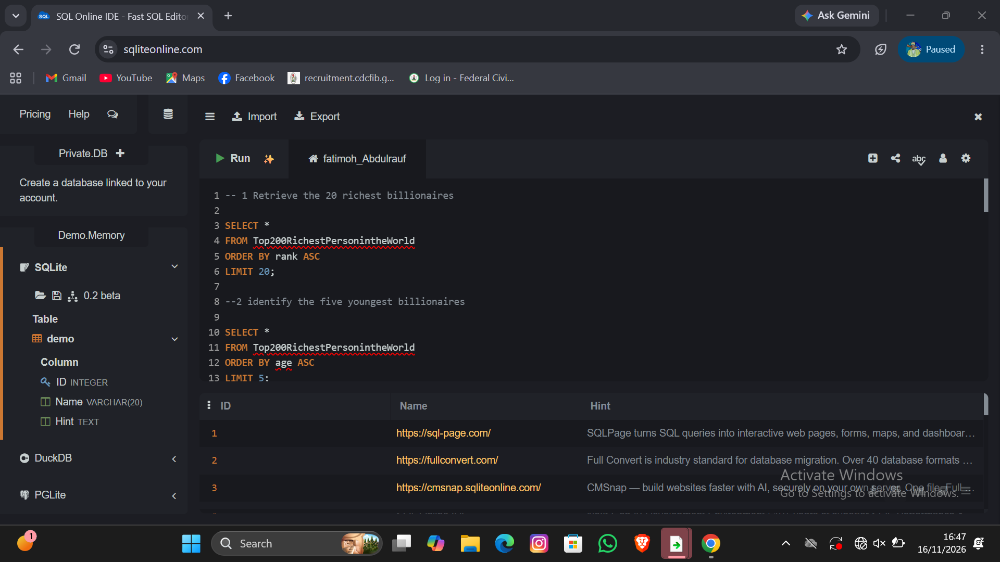

# THE BILLIONAIRE WEALTH INVESTIGATION

## INTRODUCTION 
As a Data Analyst at a global financial research organization, I conducted an exploratory data analysis (EDA) on the world's top 200 richest individuals. My primary objective for this project was to investigate global wealth distribution, industry dominance, age demographics, and country-level representation using structured SQL queries to extract meaningful financial insights. 

## DATASET DESCRIPTION

The Top 200 Richest Person in the World Dataset provides detailed information on the wealthiest individuals globally, based on the Forbes list. It includes key data points used to analyze global wealth trends, industry dominance, and demographics:  

Serial Number: The sequential index or row number assigned to each billionaire in the dataset.  

Rank: The individual's official global position based on their total net worth (where rank 1 represents the wealthiest person).  

Name: The full legal name or family group name of the billionaire.  

Age: The current age of the billionaire measured in years.  

Country: The primary country of origin, citizenship, or residence associated with the billionaire.  

Net Worth (In Billion Dollars): The individual's total estimated net worth, expressed in billions of US dollars ($B).  

Industry: The primary business sector or industry from which the billionaire's wealth is predominantly derived.  


## TOOLS USED

- SQL Dialect: SQLite
- Development Environment: SQLiteOnline IDE
- SQL Concepts: GROUP BY, HAVING, Subqueries, and Aggregate Functions
- Project Hosting: GitHub

## SQL SKILLS DEMONSTRATED

Data retrieval using SELECT

Filtering using WHERE

Sorting using ORDER BY

Grouping using GROUP BY

Filtering grouped data using HAVING

Aggregate functions

Subqueries

## BUSINESS QUESTIONS ANSWERED
- Retrieve the 20 richest billionaires
- Identify the five youngest billionaires
- Calculate the average age and average net-worth
- Identify the five most represented countries
- Calculate the combined net-worth of billionaires from each country
- Identify the five industries with highest number of billionaires
- Find countries with at least five billionaires
- Calculate the total wealth of billionaires younger than 50
- Identify billionaires whose net-worth exceeds the overall average net-worth
- Identify the industries with the highest average net-worth 


## KEY FINDINGS & INSIGHTS
Wealth Concentration: The global average net worth across the top 200 individuals is $31.84 Billion, while the average age is 69.38 years.

Geographic Dominance: The United States heavily dominates the dataset with 79 billionaires (~39.5% of total representation), controlling over $3.2 Trillion in combined wealth. China (16) and India (13) rank second and third.
Industry Leaders: Technology leads as the top sector with 40 billionaires, closely followed by Finance & Investments (32) and Fashion & Retail (30).

High-Cap Capital Density: Although Technology has the highest volume of billionaires, Telecom commands the highest average net worth per individual ($102.0 Billion), driven by high capital concentration per individual.

Youth & Wealth: Billionaires under the age of 50 collectively hold $508.3 Billion, led by young tech and inherited wealth figures like Mark Mateschitz ($39.6B) and Clemente Del Vecchio ($4.7B).

## CONCLUSION
This project provided valuable hands-on experience in using SQL to solve business queries and analyze complex, real-world financial datasets. Through data filtering, aggregation, and subqueries, I was able to transform raw data into clear, actionable insights regarding global wealth concentration, industry distribution, and demographic trends. 


## REPOSITORY STRUCTURE
```billionaire-wealth-sql-investigation
├── SQL_project_screenshot.png                # Execution screenshot preview
├── Top 200 Richest Person in the World.csv   # Raw CSV dataset
├── billionaire_analysis.sql                  # Combined SQL analysis queries
├── Results/                                  # Individual query scripts
└── README.md                                 # Project documentation
```
